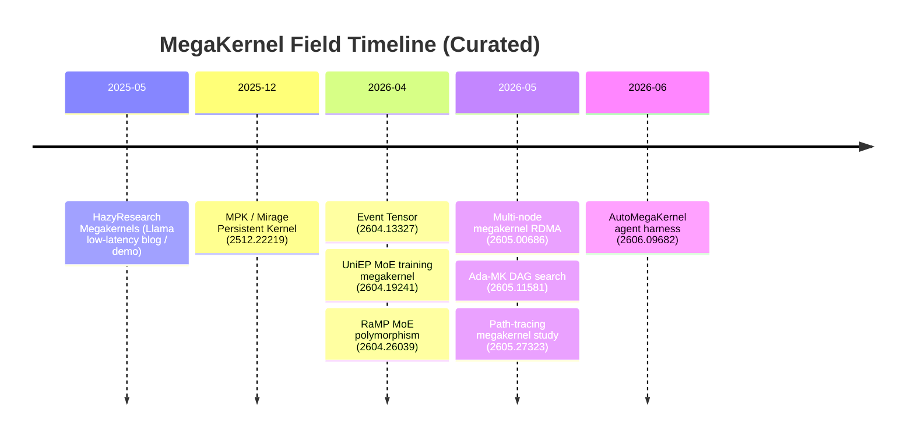
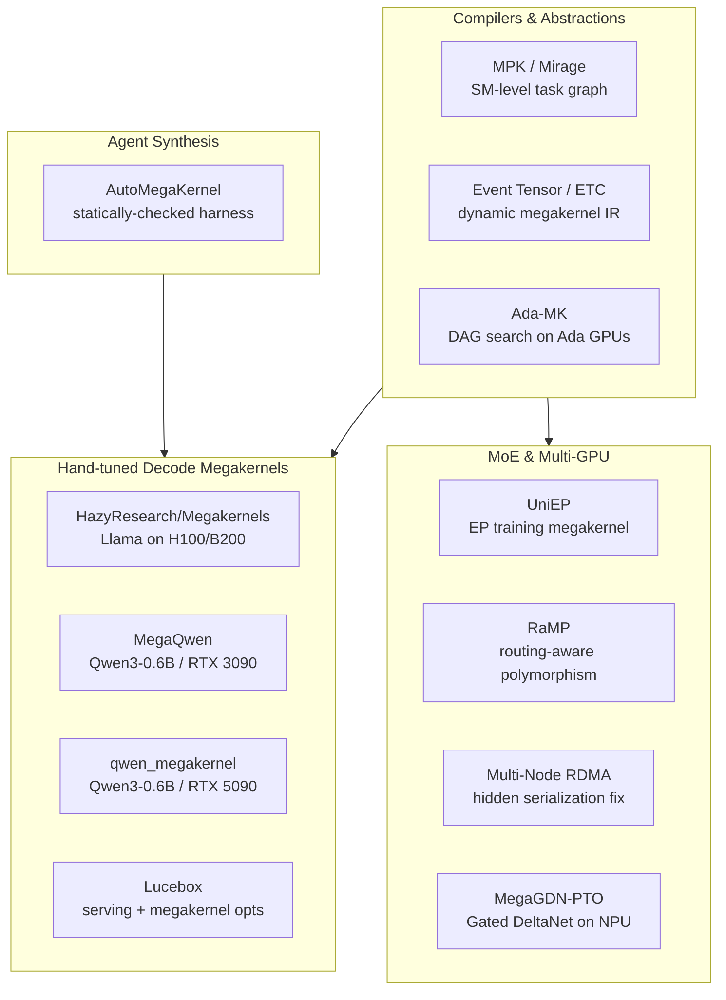

# 🚀 Awesome MegaKernel

### _A Curated Collection of Megakernel Research & Systems for LLM Inference / Training_

[中文 README](README.zh-CN.md)

[📖 Introduction](#-introduction) • [🗺️ Landscape](#-landscape) • [📚 Papers](#-research-papers) • [🧰 Repos](#-open-source-systems--repos) • [🤝 Contributing](#-contributing)

---

## 📖 Introduction

**Awesome MegaKernel** tracks research and open-source systems that fuse many GPU operators into a **single persistent kernel launch** (a *megakernel* / *mega-kernel* / *persistent kernel*).

### Why megakernels?

In LLM decode (especially batch=1 / low-latency serving), end-to-end time is often dominated by:

- **Kernel launch overhead** — thousands of launches per token
- **Inter-kernel HBM round-trips** — activations bounce through global memory between operators
- **Coarse synchronization** — host/device barriers that block compute–comm overlap

A megakernel keeps SMs resident, schedules tiled tasks inside one launch, and can overlap compute / communication at finer granularity than the conventional kernel-per-operator model.

### Scope of this list

| In scope | Out of scope (for now) |
| :------- | :--------------------- |
| End-to-end / multi-op persistent kernels for LLM inference or training | Single-op kernels (FlashAttention, etc.) unless framed as megakernel building blocks |
| Megakernel compilers, DSLs, schedulers, agent synthesizers | Generic CUDA optimization tutorials |
| MoE / multi-GPU megakernel communication | Pure framework wrappers with no fused kernel story |

### Related lists

- [Awesome LLM Kernel Agent](https://github.com/qhy991/Awesome-LLM-Kernel-Agent) — LLM/agent-driven *kernel generation*
- This list focuses on **megakernel systems themselves** (hand-written, compiled, or agent-synthesized)

---

## 🗺️ Landscape

---

## 📚 Research Papers

### Compilers, IR & Adaptive Search

| Title | Venue | Date | Code | First / Last Author | Topics |
| :---- | :---: | :---: | :---: | :---: | :---: |
| [**Ada-MK: Adaptive MegaKernel Optimization via Automated DAG-based Search for LLM Inference**](https://arxiv.org/abs/2605.11581) | arXiv | 2026-05 | - | Wenxin Dong / Lin Liu | `LLM-Inference` `DAG-Search` `Ada-GPU` `Latency` |
| [**Event Tensor: A Unified Abstraction for Compiling Dynamic Megakernel**](https://arxiv.org/abs/2604.13327) | arXiv | 2026-04 | - | Hongyi Jin / Todd C. Mowry* | `Compiler` `Dynamic-Shapes` `Scheduling` `LLM-Serving` |
| [**MPK: A Compiler and Runtime for Mega-Kernelizing Tensor Programs**](https://arxiv.org/abs/2512.22219) | arXiv | 2025-12 | [mirage](https://github.com/mirage-project/mirage) | Xinhao Cheng / Tianqi Chen* | `Compiler` `Multi-GPU` `SM-Graph` `Persistent-Kernel` |

\*Last author inferred from author list / affiliation block; verify on arXiv.

**Quick takeaways**

- **MPK / Mirage** — first end-to-end compiler+runtime that turns multi-GPU LLM inference into one mega-kernel via an SM-level task graph; enables cross-op software pipelining and fine-grained compute–comm overlap.
- **Event Tensor** — IR for *dynamic* megakernels (shape- and data-dependent tasks); ETC schedules static/dynamic persistent kernels for serving latency + lower warmup.
- **Ada-MK** — targets resource-constrained Ada-class GPUs where hand-tuned megakernels don’t port; searches DAG fusions under strict ms-level latency budgets (e.g. ads serving).

### MoE, Training & Multi-Node Communication

| Title | Venue | Date | Code | First / Last Author | Topics |
| :---- | :---: | :---: | :---: | :---: | :---: |
| [**Eliminating Hidden Serialization in Multi-Node Megakernel Communication**](https://arxiv.org/abs/2605.00686) | arXiv | 2026-05 | - | Byungsoo Oh / Rachee Singh | `MoE` `Multi-Node` `RDMA` `Communication` |
| [**RaMP: Runtime-Aware Megakernel Polymorphism for Mixture-of-Experts**](https://arxiv.org/abs/2604.26039) | arXiv | 2026-04 | - | Vyom Sharma / Debajyoti Datta | `MoE` `Polymorphism` `CuTe` `vLLM` |
| [**UniEP: Unified Expert-Parallel MoE MegaKernel for LLM Training**](https://arxiv.org/abs/2604.19241) | arXiv | 2026-04 | [Triton-distributed*](https://github.com/ByteDance-Seed/Triton-distributed) | Size Zheng / Jidong Zhai | `MoE` `Training` `Expert-Parallel` `Overlap` |

\*Verify the exact code path in the paper / ByteDance Seed releases.

**Quick takeaways**

- **UniEP** — brings megakernel ideas from inference into **MoE training**: fuse Dispatch+GroupGEMM / GroupGEMM+Combine with deterministic token ordering for numerical stability; reports 1.03–1.38× vs SOTA on Hopper clusters.
- **RaMP** — MoE kernel configs should depend on *routing histogram*, not batch size alone; wave cost model + polymorphic CuTe kernels → ~1.2–1.3× e2e in vLLM vs strong baselines.
- **Multi-node megakernel RDMA** — single-node MoE megakernels can regress badly across nodes due to proxy RDMA *hidden serialization*; paper diagnoses fence/ordering issues and proposes fixes.

### Agent-Driven Megakernel Synthesis

| Title | Venue | Date | Code | First / Last Author | Topics |
| :---- | :---: | :---: | :---: | :---: | :---: |
| [**AutoMegaKernel: A Statically-Checked Agent Harness for Self-Retargeting Megakernel Synthesis**](https://arxiv.org/abs/2606.09682) | arXiv | 2026-06 | [AutoMegaKernel](https://github.com/RightNow-AI/AutoMegaKernel) | Jaber Jaber / Osama Jaber | `Agent` `Verification` `Self-Retargeting` `Llama` |

**Quick takeaways**

- Compiles HF Llama-family models into one persistent cooperative CUDA megakernel **without per-model hand-written CUDA**.
- Frozen schedule-IR validator rejects unsafe agent schedules (deadlock/race checks) before launch; same source retargets sm_80 / sm_90 / sm_120.

### Adjacent Work (Graphics / Non-LLM)

| Title | Venue | Date | Code | First / Last Author | Topics |
| :---- | :---: | :---: | :---: | :---: | :---: |
| [**Megakernel vs Wavefront GPU Path Tracing**](https://arxiv.org/abs/2605.27323) | arXiv | 2026-05 | - | Rafael Padilla / Austin Kim | `Path-Tracing` `RT-Cores` `Wavefront` `Graphics` |

Useful as a classical megakernel vs wavefront comparison outside LLM—helps separate *fusion strategy* from *LLM-specific* concerns.

---

## 🧰 Open-Source Systems & Repos

### Compilers & Agent Harnesses

| Project | Stars | One-line | Link |
| :------ | :---: | :------- | :--- |
|  **Mirage Persistent Kernel (MPK)** | - | Compiler + runtime that mega-kernelizes multi-GPU LLM inference | [mirage-project/mirage](https://github.com/mirage-project/mirage) |
|  **AutoMegaKernel** | - | Agent harness: compile → validate → verify → self-tune a Llama megakernel | [RightNow-AI/AutoMegaKernel](https://github.com/RightNow-AI/AutoMegaKernel) |

### Hand-tuned / Model-Specific Megakernels

| Project | Target | Hardware | Highlight | Link |
| :------ | :----- | :------- | :-------- | :--- |
|  **Megakernels** | Llama (low-latency demo) | H100 / B200 | Full forward pass as one megakernel; ThunderKittens-based | [HazyResearch/Megakernels](https://github.com/HazyResearch/Megakernels) |
|  **MegaQwen** | Qwen3-0.6B | RTX 3090 | ~530 tok/s decode (~3.9× vs HF); strong learning writeup | [Infatoshi/MegaQwen](https://github.com/Infatoshi/MegaQwen) |
|  **qwen_megakernel** | Qwen3-0.6B bf16 | RTX 5090 | ~1036 tok/s (~8.4× vs HF); CUDA ≥ 12.8 | [AlpinDale/qwen_megakernel](https://github.com/AlpinDale/qwen_megakernel) |
|  **megagdn-pto** | Gated DeltaNet (Qwen3.5/3.6, KDA) | Ascend NPU | PTO-ISA megakernel; ~1.5–3× vs Triton; vLLM-Ascend hook | [huawei-csl/megagdn-pto](https://github.com/huawei-csl/megagdn-pto) |

### Serving Systems Using Megakernel Techniques

| Project | Stars | One-line | Link |
| :------ | :---: | :------- | :--- |
|  **Lucebox** | - | Fast local LLM server; per-model megakernel / speculative prefill & decode opts | [Luce-Org/lucebox](https://github.com/Luce-Org/lucebox) |

### Reading / Background

- [Look Ma, No Bubbles! Designing a Low-Latency Megakernel for Llama-1B](https://hazyresearch.stanford.edu/blog/2025-05-27-no-bubbles) — Hazy Research blog (motivation for [Megakernels](https://github.com/HazyResearch/Megakernels))
- [AlpinDale: RTX 5090 decode optimization](https://blog.alpindale.net/posts/5090_decode_optimization/) — writeup behind `qwen_megakernel`
- Mirage docs / roadmap — see [mirage-project/mirage](https://github.com/mirage-project/mirage)

---

## 🧭 How to Navigate the Space

| If you want… | Start here |
| :----------- | :--------- |
| Automatic multi-GPU megakernel compilation | **MPK / Mirage** + paper `2512.22219` |
| Dynamic shapes / data-dependent tasks | **Event Tensor** `2604.13327` |
| Agent that writes megakernels safely | **AutoMegaKernel** `2606.09682` |
| Maximum batch-1 decode on a consumer GPU | **MegaQwen** / **qwen_megakernel** |
| Production-style MoE serving kernels | **RaMP** `2604.26039` |
| MoE *training* overlap | **UniEP** `2604.19241` |
| NPU megakernel for linear-attention family | **megagdn-pto** |
| End-to-end local serving product | **Lucebox** |

---

## 🤝 Contributing

PRs welcome — see [CONTRIBUTING.md](CONTRIBUTING.md).

Please keep English (`README.md`) and Chinese (`README.zh-CN.md`) in sync when adding entries.

---

## 📄 License

Content in this repository is curated under [CC0 1.0](https://creativecommons.org/publicdomain/zero/1.0/) (list metadata). Linked projects retain their own licenses.
