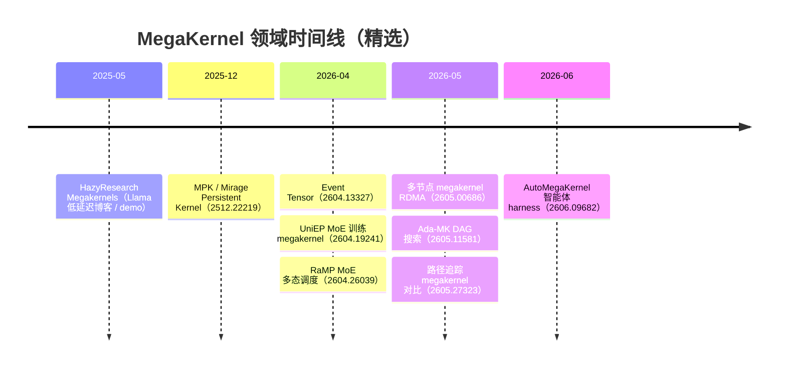
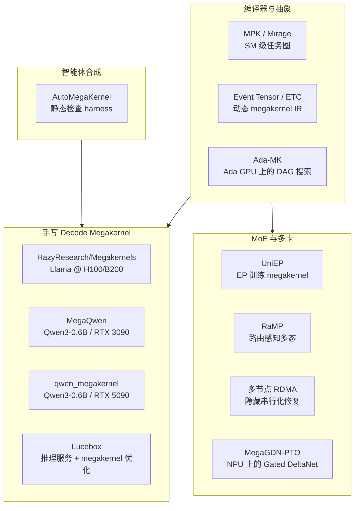

# 🚀 Awesome MegaKernel

### _MegaKernel 研究与系统精选：面向 LLM 推理 / 训练的端到端持久化内核_

[English README](README.md)

[📖 简介](#-简介) • [🗺️ 全景](#-全景) • [📚 论文](#-研究论文) • [🧰 仓库](#-开源系统与仓库) • [🤝 贡献](#-贡献指南)

---

## 📖 简介

**Awesome MegaKernel** 收集将多个 GPU 算子融合为**单次持久化 kernel launch**（megakernel / mega-kernel / persistent kernel）的研究与开源系统。

### 为什么需要 Megakernel？

在 LLM decode（尤其是 batch=1 / 低延迟服务）中，端到端耗时常常被以下因素主导：

- **Kernel launch 开销** — 每个 token 可能触发成百上千次 launch
- **算子间 HBM 往返** — activation 在算子边界反复落全局内存
- **粗粒度同步** — host/device barrier 阻碍细粒度算通重叠

Megakernel 让 SM 常驻 GPU，在一次 launch 内调度分块任务，从而以比「一算子一 kernel」更细的粒度重叠计算与通信。

### 收录范围

| 纳入 | 暂不纳入 |
| :--- | :------- |
| LLM 推理/训练的端到端或多算子持久化内核 | 单算子内核（如 FlashAttention），除非明确作为 megakernel 积木 |
| Megakernel 编译器、DSL、调度器、智能体合成系统 | 泛化 CUDA 优化教程 |
| MoE / 多 GPU megakernel 通信 | 无融合内核故事的纯框架封装 |

### 相关列表

- [Awesome LLM Kernel Agent](https://github.com/qhy991/Awesome-LLM-Kernel-Agent) — LLM/Agent **生成与优化内核**
- 本列表聚焦 **megakernel 系统本身**（手写、编译或 Agent 合成）

---

## 🗺️ 全景

---

## 📚 研究论文

### 编译器、IR 与自适应搜索

| 标题 | 会议/源 | 日期 | 代码 | 一作 / 末作 | 主题 |
| :--- | :---: | :---: | :---: | :---: | :---: |
| [**Ada-MK: Adaptive MegaKernel Optimization via Automated DAG-based Search for LLM Inference**](https://arxiv.org/abs/2605.11581) | arXiv | 2026-05 | - | Wenxin Dong / Lin Liu | `LLM-Inference` `DAG-Search` `Ada-GPU` `Latency` |
| [**Event Tensor: A Unified Abstraction for Compiling Dynamic Megakernel**](https://arxiv.org/abs/2604.13327) | arXiv | 2026-04 | - | Hongyi Jin / Todd C. Mowry* | `Compiler` `Dynamic-Shapes` `Scheduling` `LLM-Serving` |
| [**MPK: A Compiler and Runtime for Mega-Kernelizing Tensor Programs**](https://arxiv.org/abs/2512.22219) | arXiv | 2025-12 | [mirage](https://github.com/mirage-project/mirage) | Xinhao Cheng / Tianqi Chen* | `Compiler` `Multi-GPU` `SM-Graph` `Persistent-Kernel` |

\*末作根据作者列表/单位块推断，请以 arXiv 页面为准。

**要点**

- **MPK / Mirage**：首个将多 GPU LLM 推理自动变成单一 mega-kernel 的编译器+运行时；SM 级任务图支持跨算子流水与细粒度算通重叠。
- **Event Tensor**：面向*动态* megakernel（形状/数据相关任务）的统一 IR；ETC 生成静/动态持久化内核，降低 serving 延迟与 warmup。
- **Ada-MK**：面向资源受限的 Ada 类 GPU；在毫秒级延迟约束下用 DAG 搜索做融合，缓解手写 megakernel 难移植问题。

### MoE、训练与多节点通信

| 标题 | 会议/源 | 日期 | 代码 | 一作 / 末作 | 主题 |
| :--- | :---: | :---: | :---: | :---: | :---: |
| [**Eliminating Hidden Serialization in Multi-Node Megakernel Communication**](https://arxiv.org/abs/2605.00686) | arXiv | 2026-05 | - | Byungsoo Oh / Rachee Singh | `MoE` `Multi-Node` `RDMA` `Communication` |
| [**RaMP: Runtime-Aware Megakernel Polymorphism for Mixture-of-Experts**](https://arxiv.org/abs/2604.26039) | arXiv | 2026-04 | - | Vyom Sharma / Debajyoti Datta | `MoE` `Polymorphism` `CuTe` `vLLM` |
| [**UniEP: Unified Expert-Parallel MoE MegaKernel for LLM Training**](https://arxiv.org/abs/2604.19241) | arXiv | 2026-04 | [Triton-distributed*](https://github.com/ByteDance-Seed/Triton-distributed) | Size Zheng / Jidong Zhai | `MoE` `Training` `Expert-Parallel` `Overlap` |

\*具体代码路径请以论文 / ByteDance Seed 发布为准。

**要点**

- **UniEP**：把 megakernel 思路从推理带到 **MoE 训练**——融合 Dispatch+GroupGEMM / GroupGEMM+Combine，并用确定性 token 序保证数值稳定；Hopper 集群相对 SOTA 约 1.03–1.38×。
- **RaMP**：MoE kernel 配置应依赖*路由直方图*而非仅 batch size；波次代价模型 + CuTe 多态内核，在 vLLM 中相对强基线约 1.2–1.3× e2e。
- **多节点 megakernel RDMA**：单节点 MoE megakernel 跨节点可能因 proxy RDMA *隐藏串行化*严重回退；论文定位 fence/排序问题并提出修复。

### Agent 驱动的 Megakernel 合成

| 标题 | 会议/源 | 日期 | 代码 | 一作 / 末作 | 主题 |
| :--- | :---: | :---: | :---: | :---: | :---: |
| [**AutoMegaKernel: A Statically-Checked Agent Harness for Self-Retargeting Megakernel Synthesis**](https://arxiv.org/abs/2606.09682) | arXiv | 2026-06 | [AutoMegaKernel](https://github.com/RightNow-AI/AutoMegaKernel) | Jaber Jaber / Osama Jaber | `Agent` `Verification` `Self-Retargeting` `Llama` |

**要点**

- 将 HF Llama 族模型编译为单个持久化 cooperative CUDA megakernel，**无需按模型手写 CUDA**。
- 冻结的 schedule-IR 校验器在 launch 前拒绝不安全调度（死锁/竞态检查）；同一源码可重定向到 sm_80 / sm_90 / sm_120。

### 相邻工作（图形学 / 非 LLM）

| 标题 | 会议/源 | 日期 | 代码 | 一作 / 末作 | 主题 |
| :--- | :---: | :---: | :---: | :---: | :---: |
| [**Megakernel vs Wavefront GPU Path Tracing**](https://arxiv.org/abs/2605.27323) | arXiv | 2026-05 | - | Rafael Padilla / Austin Kim | `Path-Tracing` `RT-Cores` `Wavefront` `Graphics` |

有助于在非 LLM 场景下对比 megakernel 与 wavefront 策略，区分「融合策略」与「LLM 特有问题」。

---

## 🧰 开源系统与仓库

### 编译器与 Agent Harness

| 项目 | Stars | 一句话 | 链接 |
| :--- | :---: | :----- | :--- |
|  **Mirage Persistent Kernel (MPK)** | - | 将多 GPU LLM 推理 mega-kernel 化的编译器 + 运行时 | [mirage-project/mirage](https://github.com/mirage-project/mirage) |
|  **AutoMegaKernel** | - | Agent harness：编译 → 校验 → 验证 → 自调优 Llama megakernel | [RightNow-AI/AutoMegaKernel](https://github.com/RightNow-AI/AutoMegaKernel) |

### 手写 / 模型专用 Megakernel

| 项目 | 目标模型 | 硬件 | 亮点 | 链接 |
| :--- | :------- | :--- | :--- | :--- |
|  **Megakernels** | Llama（低延迟 demo） | H100 / B200 | 整段 forward 单 kernel；基于 ThunderKittens | [HazyResearch/Megakernels](https://github.com/HazyResearch/Megakernels) |
|  **MegaQwen** | Qwen3-0.6B | RTX 3090 | Decode ~530 tok/s（相对 HF ~3.9×）；文档详尽 | [Infatoshi/MegaQwen](https://github.com/Infatoshi/MegaQwen) |
|  **qwen_megakernel** | Qwen3-0.6B bf16 | RTX 5090 | ~1036 tok/s（相对 HF ~8.4×）；需 CUDA ≥ 12.8 | [AlpinDale/qwen_megakernel](https://github.com/AlpinDale/qwen_megakernel) |
|  **megagdn-pto** | Gated DeltaNet（Qwen3.5/3.6、KDA） | Ascend NPU | PTO-ISA megakernel；相对 Triton ~1.5–3×；可挂 vLLM-Ascend | [huawei-csl/megagdn-pto](https://github.com/huawei-csl/megagdn-pto) |

### 使用 Megakernel 技术的推理服务

| 项目 | Stars | 一句话 | 链接 |
| :--- | :---: | :----- | :--- |
|  **Lucebox** | - | 面向速度的本地 LLM 服务；按模型/硬件定制 megakernel 与投机推理 | [Luce-Org/lucebox](https://github.com/Luce-Org/lucebox) |

### 延伸阅读

- [Look Ma, No Bubbles! Designing a Low-Latency Megakernel for Llama-1B](https://hazyresearch.stanford.edu/blog/2025-05-27-no-bubbles) — Hazy Research 博客（[Megakernels](https://github.com/HazyResearch/Megakernels) 动机）
- [AlpinDale: RTX 5090 decode optimization](https://blog.alpindale.net/posts/5090_decode_optimization/) — `qwen_megakernel` 背后的实践笔记
- Mirage 文档 / roadmap — 见 [mirage-project/mirage](https://github.com/mirage-project/mirage)

---

## 🧭 怎么选入口

| 你想… | 从这里开始 |
| :----- | :--------- |
| 自动多 GPU megakernel 编译 | **MPK / Mirage** + 论文 `2512.22219` |
| 动态形状 / 数据相关任务 | **Event Tensor** `2604.13327` |
| 安全地让 Agent 写 megakernel | **AutoMegaKernel** `2606.09682` |
| 消费级 GPU 上极致 batch-1 decode | **MegaQwen** / **qwen_megakernel** |
| 生产向 MoE serving 内核 | **RaMP** `2604.26039` |
| MoE *训练* 算通重叠 | **UniEP** `2604.19241` |
| 线性注意力族的 NPU megakernel | **megagdn-pto** |
| 端到端本地推理产品 | **Lucebox** |

---

## 🤝 贡献指南

欢迎 PR —— 详见 [CONTRIBUTING.md](CONTRIBUTING.md)。

新增条目时请尽量同步更新英文 `README.md` 与中文 `README.zh-CN.md`。

---

## 📄 License

本仓库列表内容采用 [CC0 1.0](https://creativecommons.org/publicdomain/zero/1.0/)。被链接项目保留各自许可证。
